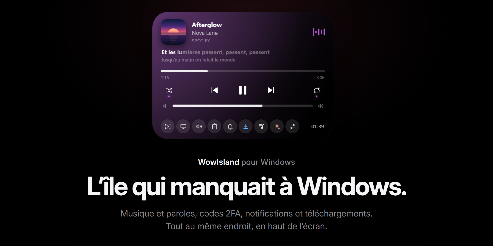
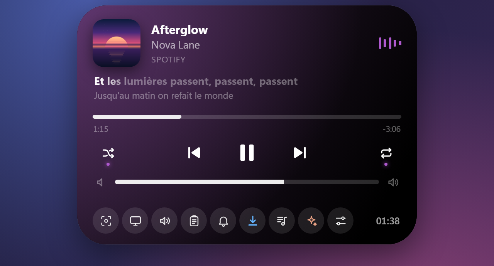
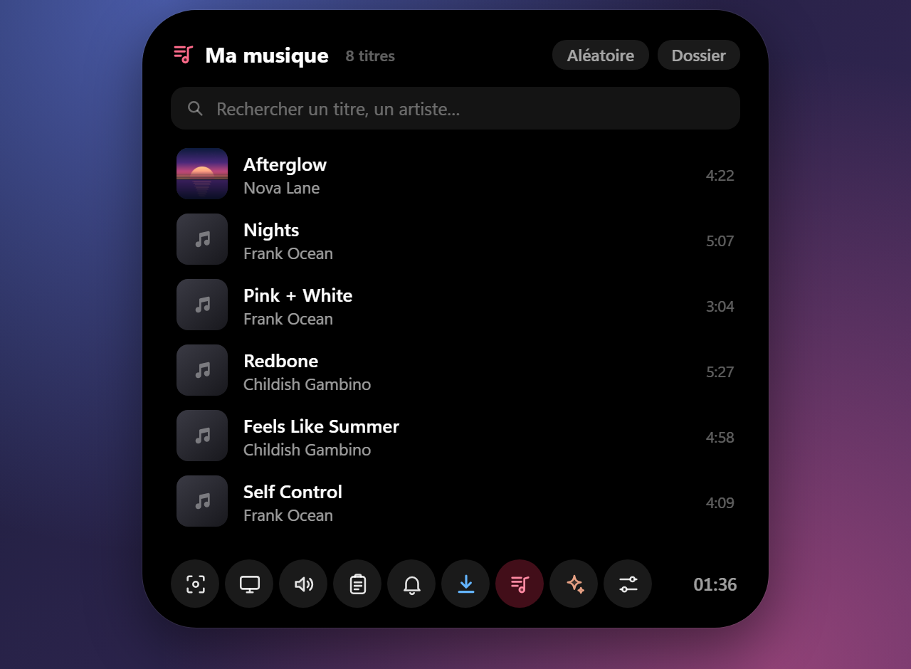
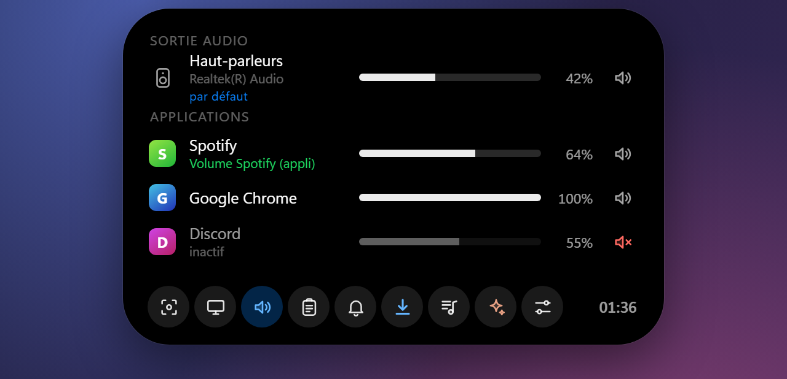
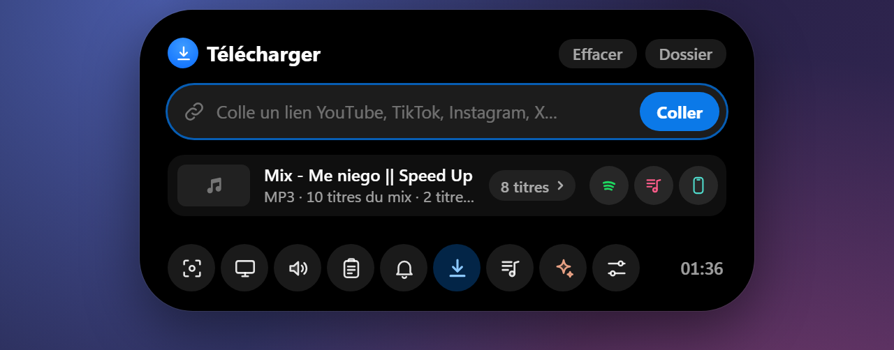
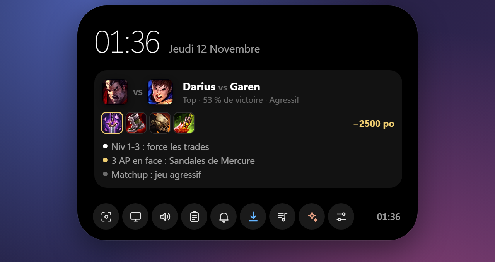
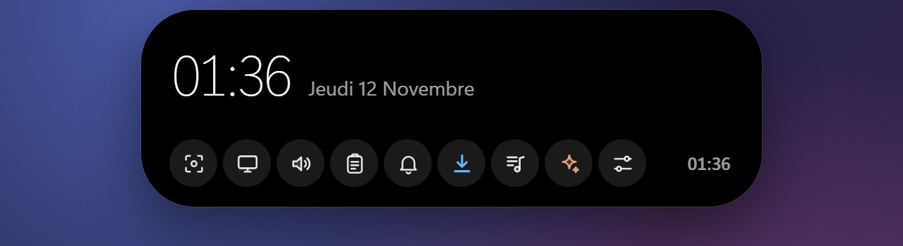

<p align="center">
  
</p>

<p align="center">
  <a href="https://github.com/Belius303/wowisland/releases/latest"></a>
  
  
  <a href="LICENSE"></a>
</p>

<p align="center">
  <a href="README.md">English</a> · <b>Français</b>
</p>

<p align="center">
  <a href="https://github.com/Belius303/wowisland/releases/latest/download/WowIsland.exe"><b>⬇️ Télécharger WowIsland.exe</b></a>
  &nbsp;·&nbsp; un seul petit exe, sans installation, ~11 Mo
</p>

---

**WowIsland** pose une île vivante en haut de ton écran. Elle affiche la musique en cours avec les paroles synchronisées, fait apparaître tes codes 2FA déjà copiés, regroupe tes notifications, télécharge des vidéos, envoie des fichiers sur ton téléphone… et se fait oublier le reste du temps.

Elle est transparente et laisse passer les clics partout sauf sur l'île, ne vole jamais le focus et n'apparaît ni dans la barre des tâches ni dans Alt-Tab. Écrite en **Rust** (Tauri v2 + WinRT). L'interface est en **français et en anglais**.

## Petit tour

<table>
  <tr>
    <td width="50%" valign="top"><br><b>Les paroles en karaoké.</b> La ligne chantée s'illumine au fil des mots, directement dans l'île compacte.</td>
    <td width="50%" valign="top"><br><b>Batterie de l'iPhone</b> dès qu'il est branché en USB.</td>
  </tr>
  <tr>
    <td valign="top"><br><b>Tous les lecteurs, une seule île.</b> Spotify, navigateurs, Apple Music, Deezer, VLC… Les couleurs suivent la pochette.</td>
    <td valign="top"><br><b>Ma musique.</b> Écoute les morceaux téléchargés sans rien ouvrir d'autre.</td>
  </tr>
  <tr>
    <td valign="top"><br><b>Codes 2FA déjà copiés.</b> Gmail est surveillé en temps réel (IMAP IDLE) : il n'y a plus qu'à coller.</td>
    <td valign="top"><br><b>Notifications</b> des applis Windows et de ton iPhone (via Mobile connecté), regroupées par appli.</td>
  </tr>
  <tr>
    <td valign="top"><br><b>Vocal Discord.</b> Qui est dans le salon, qui parle, micro et casque coupés.</td>
    <td valign="top"><br><b>Mélangeur.</b> Sortie audio et volume par appli, Spotify compris.</td>
  </tr>
  <tr>
    <td valign="top"><br><b>Colle un lien, récupère le fichier.</b> Vidéo, MP3, GIF ou transcription, puis un clic pour l'envoyer sur ton téléphone avec LocalSend.</td>
    <td valign="top"><br><b>Captures et OCR en local.</b> Récupère un texte ou un QR code n'importe où à l'écran.</td>
  </tr>
  <tr>
    <td valign="top"><br><b>Coach League of Legends.</b> Des conseils courts, au bon moment, via l'API locale officielle de Riot.</td>
    <td valign="top"><br>…et un rappel discret dans l'île compacte pendant la partie.</td>
  </tr>
  <tr>
    <td colspan="2" align="center"><br><b>Accueil.</b> Survole l'île : l'heure, tes outils et ce qui se passe.</td>
  </tr>
</table>

<sub>Les captures viennent de la démo intégrée (<code>dev/demo.html</code>) avec des données inventées.</sub>

## Tout ce qu'elle fait

| | |
|---|---|
| 🎵 **Musique** | Toute appli qui utilise les contrôles multimédia de Windows : pochette, couleurs de la pochette, progression, contrôles, plusieurs sources à la fois |
| 🎤 **Paroles synchronisées** | Via [LRCLIB](https://lrclib.net) (gratuit, sans compte). En option, ligne karaoké dans l'île compacte |
| 🎚️ **Mélangeur** | Volume / muet de la sortie audio et de chaque appli. En option, volume interne de Spotify (API Web Spotify) |
| 🔑 **Codes Gmail** | Push en temps réel (IMAP IDLE). Codes 2FA / OTP affichés en grand et **déjà copiés** ; liens de connexion avec un bouton **Ouvrir** |
| 💬 **Notifications** | Notifications Windows (Discord, WhatsApp, Teams…) et de l'iPhone via Mobile connecté, codes copiés automatiquement |
| 🔋 **Batterie iPhone** | En USB (Appareils Apple / iTunes) |
| 📸 **Captures** | Zone ou plein écran, copiées et enregistrées ; OCR local (texte, QR codes) |
| ⬇️ **Téléchargements** | YouTube, TikTok, X, Reddit, Instagram… avec [yt-dlp](https://github.com/yt-dlp/yt-dlp) et ffmpeg (récupérés au premier usage) |
| 📱 **Envoi au téléphone** | [LocalSend](https://localsend.org) intégré : même Wi-Fi, rien d'autre à installer sur le PC |
| 🎧 **Vocal Discord** | Membres du salon, qui parle, micro / casque (nécessite ta propre appli développeur Discord) |
| 🤖 **Claude Code** | Une mini-session Claude Code dans l'île, plus ton quota d'utilisation (nécessite la CLI `claude`) |
| 🕹️ **Jeux** | Détecte le jeu en cours, temps de jeu, relance du dernier jeu |
| ⚔️ **Coach LoL** | API Live Client Data de Riot, recoupée avec OP.GG et Data Dragon |
| ⏱️ **Et aussi** | Minuteur, OSD volume / luminosité, voyant micro / caméra, historique du presse-papiers |

## Pour commencer

1. **[Télécharge WowIsland.exe](https://github.com/Belius303/wowisland/releases/latest/download/WowIsland.exe)** et lance-le. Pas d'installation : mets-le où tu veux.
2. Clic droit sur l'icône près de l'horloge → **Réglages**. Chaque fonction a sa section avec les étapes à suivre.
3. En option : *Réglages → Général → Lancer au démarrage de Windows*.

Survole l'île pour la déplier. Prérequis : Windows 10/11 x64 avec le runtime WebView2 (déjà inclus dans Windows 11).

> **Avertissement SmartScreen ?** L'exe n'est pas encore signé, Windows peut donc dire qu'il vient d'un éditeur inconnu : *Informations complémentaires → Exécuter quand même*. Tu peux vérifier le fichier avec le SHA-256 publié avec chaque version (`certutil -hashfile WowIsland.exe SHA256` dans un terminal), ou le compiler toi-même (plus bas).

## Vie privée

Tout reste sur ton PC, dans `%USERPROFILE%\.dynamicisland`. Les mots de passe et jetons (mots de passe d'application Gmail, jetons Spotify / Discord) sont chiffrés avec **DPAPI** de Windows, liés à ta session. Les mails ne sont jamais marqués comme lus. Pas de télémétrie, pas de compte.

WowIsland n'envoie rien à l'auteur. Elle ne parle qu'aux services des fonctions que tu actives (Gmail, LRCLIB, Spotify, Discord…), directement depuis ton PC. La liste complète est dans la **[politique de confidentialité](PRIVACY.md#politique-de-confidentialité)**.

## Signature du code

Les versions Windows sont compilées par [GitHub Actions](.github/workflows/release.yml) à partir du code de ce dépôt, et chaque version indique le SHA-256 de `WowIsland.exe`.

La signature est en cours de mise en place avec [SignPath Foundation](https://signpath.org), qui fournit des certificats gratuits aux projets open source. Une fois en place, les exécutables seront signés avec : *Free code signing provided by [SignPath.io](https://about.signpath.io), certificate by [SignPath Foundation](https://signpath.org)*.

- Contributeurs et relecteurs : [Belius303](https://github.com/Belius303)
- Approbateurs : [Belius303](https://github.com/Belius303)

Ce programme ne transfère aucune information vers d'autres systèmes en réseau, sauf à la demande explicite de l'utilisateur ou de la personne qui l'installe ou l'utilise. Voir la [politique de confidentialité](PRIVACY.md#politique-de-confidentialité).

## Compiler

```bash
cargo build --release
```

L'exe est `target\release\dynamic-island.exe` (l'interface de `ui/` est intégrée) ; renomme-le comme tu veux. Pour un installateur NSIS : `cargo install tauri-cli` puis `cargo tauri build`.

- Démo de l'interface dans un navigateur (faux événements) : `python -m http.server 8765` à la racine, puis `http://localhost:8765/dev/demo.html`.
- Captures de cette page : `node dev/shots.mjs fr` (Edge ou Chrome sans fenêtre, serveur de démo lancé).
- Tests : `cargo test` (par ex. `cargo test otp` pour l'extracteur de codes).

<details>
<summary><b>Architecture</b></summary>

```
src/
  main.rs           commandes Tauri, icône de notification, instance unique, démarrage auto
  overlay.rs        fenêtre overlay, clics traversants par test du curseur, détection plein écran
  media.rs          sessions média Windows (GSMTC)        lyrics.rs   paroles LRCLIB
  audio.rs          mélangeur WASAPI                      osd.rs      OSD volume / luminosité
  spotify.rs        API Web Spotify (OAuth PKCE)          discord.rs  RPC local Discord
  notifications.rs  UserNotificationListener              winnotif.rs notifications « île seule »
  gmail.rs          IMAP IDLE + analyse MIME              otp.rs      extraction codes / liens
  iphone.rs         batterie via usbmuxd / lockdown       screenshot.rs, ocr.rs
  grab.rs           téléchargements yt-dlp / ffmpeg       localsend.rs envoi LocalSend v2
  player.rs         lecteur « Ma musique »                games.rs, lol.rs
  claude.rs         mini-session Claude Code + quota      config.rs   config JSON + DPAPI
ui/
  index.html, style.css, app.js   l'île
  settings.html                   fenêtre des réglages
  i18n.js, i18n-en.js             traduction anglaise (l'interface est écrite en français)
assets/brand/                     icône (SVG + PNG)
dev/demo.html, dev/shots.mjs      démo avec faux événements, générateur de captures
```
</details>

## Bon à savoir

- **Téléchargements :** ne télécharge que ce que tu as le droit de télécharger (tes vidéos, contenus libres / Creative Commons…). Respecte les conditions des sites et le droit d'auteur.
- **Le quota Claude Code** est lu sur le même point d'accès que la CLI Claude Code, avec ta connexion locale (en mémoire seulement, jamais stockée ni journalisée). C'est non officiel et peut cesser de marcher.
- **Les notifications iPhone** passent par Mobile connecté (Phone Link) de Microsoft : il n'existe pas d'API publique pour parler directement à l'iPhone depuis Windows.
- Gmail : les comptes Google Workspace dont l'admin a désactivé IMAP ou les mots de passe d'application ne marcheront pas.
- WowIsland n'est affilié ni à Apple, ni à Spotify, ni à Discord, ni à Riot Games, ni à Anthropic. « Dynamic Island » est une marque d'Apple Inc.

## Crédits

Créé par [Belius303](https://github.com/Belius303), avec l'aide de l'IA.

## Licence

[MIT](LICENSE)
