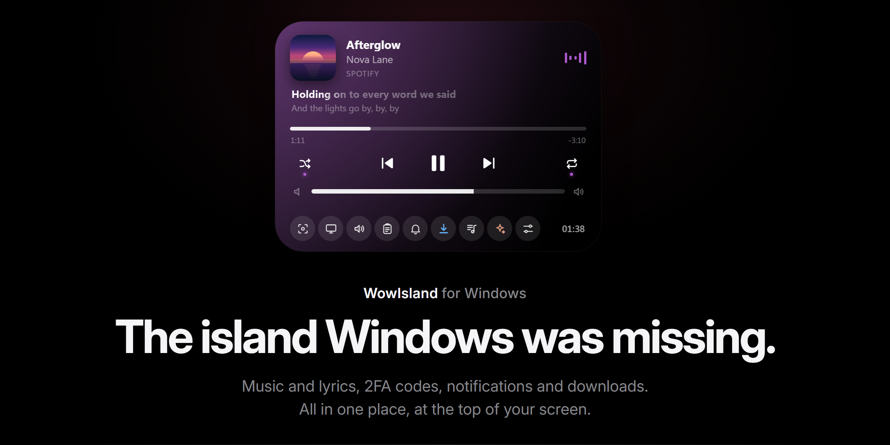
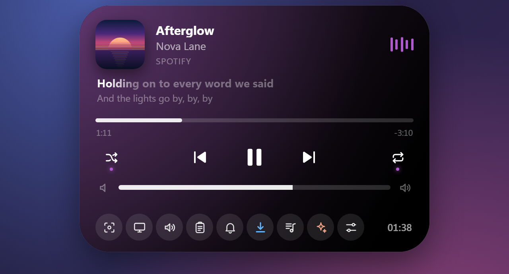
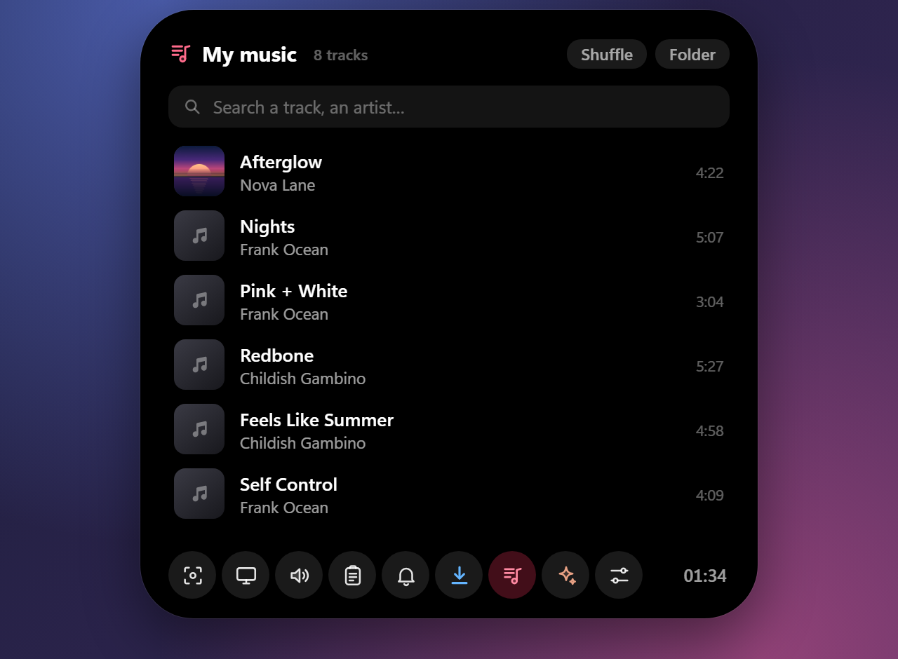
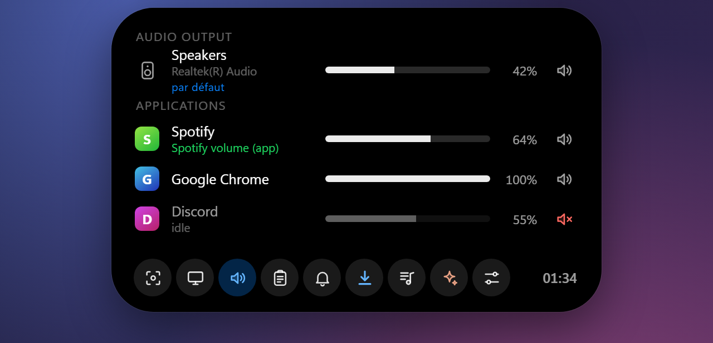
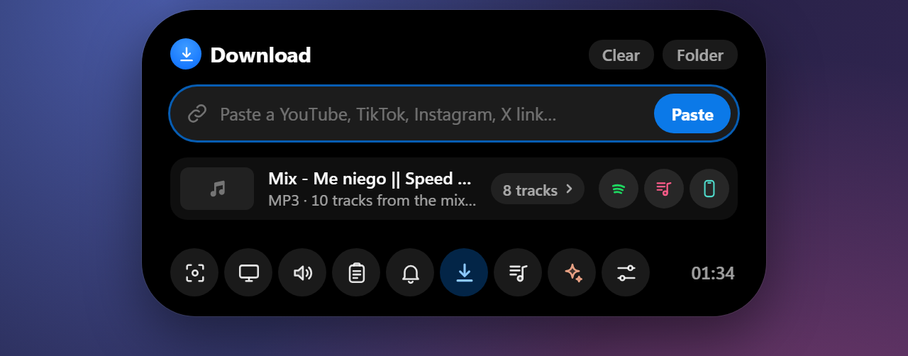
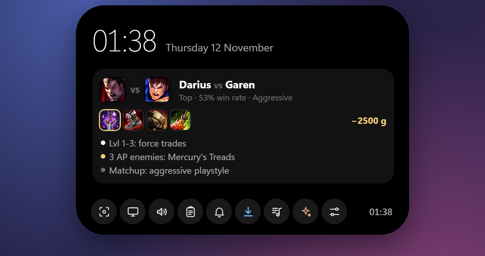
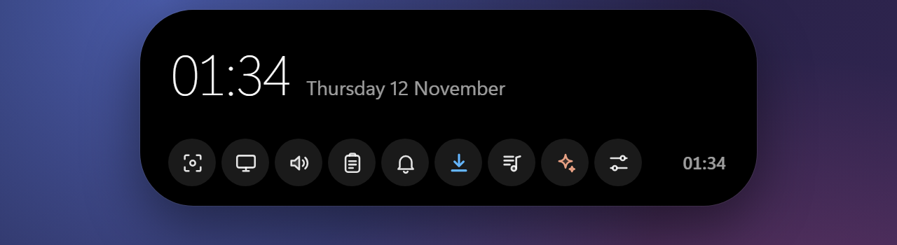

<p align="center">
  
</p>

<p align="center">
  <a href="https://github.com/Belius303/wowisland/releases/latest"></a>
  
  
  <a href="LICENSE"></a>
</p>

<p align="center">
  <b>English</b> · <a href="README.fr.md">Français</a>
</p>

<p align="center">
  <a href="https://github.com/Belius303/wowisland/releases/latest/download/WowIsland.exe"><b>⬇️ Download WowIsland.exe</b></a>
  &nbsp;·&nbsp; one small exe, no installer, ~11 MB
</p>

---

**WowIsland** puts a living, breathing island at the top of your screen. It shows what's playing with synced lyrics, pops up your 2FA codes already copied, groups your notifications, downloads videos, sends files to your phone… and gets out of the way the rest of the time.

It's transparent and click-through everywhere except on the island, never steals focus, and doesn't show up in the taskbar or Alt-Tab. Written in **Rust** (Tauri v2 + WinRT). The interface is in **English and French**.

## A tour

<table>
  <tr>
    <td width="50%" valign="top"><br><b>Lyrics, karaoke style.</b> The line being sung lights up word by word, right in the compact island.</td>
    <td width="50%" valign="top"><br><b>iPhone battery</b> as soon as it's plugged in over USB.</td>
  </tr>
  <tr>
    <td valign="top"><br><b>Every player, one island.</b> Spotify, browsers, Apple Music, Deezer, VLC… Colors follow the album art.</td>
    <td valign="top"><br><b>My music.</b> Play the tracks you downloaded, without opening anything else.</td>
  </tr>
  <tr>
    <td valign="top"><br><b>2FA codes, already copied.</b> Gmail is watched in real time (IMAP IDLE); just paste.</td>
    <td valign="top"><br><b>Notifications</b> from Windows apps and your iPhone (via Phone Link), grouped by app.</td>
  </tr>
  <tr>
    <td valign="top"><br><b>Discord voice.</b> Who's in the channel, who's talking, mute and deafen.</td>
    <td valign="top"><br><b>Mixer.</b> Output device and per-app volume, Spotify included.</td>
  </tr>
  <tr>
    <td valign="top"><br><b>Paste a link, get the file.</b> Video, MP3, GIF or transcript, then one click to send it to your phone with LocalSend.</td>
    <td valign="top"><br><b>Screenshots and local OCR.</b> Grab text or a QR code from anywhere on screen.</td>
  </tr>
  <tr>
    <td valign="top"><br><b>League of Legends coach.</b> Short, timely tips from Riot's official local API.</td>
    <td valign="top"><br>…and a discreet reminder in the compact island while you play.</td>
  </tr>
  <tr>
    <td colspan="2" align="center"><br><b>Home.</b> Hover the island: the time, your tools, and whatever's going on.</td>
  </tr>
</table>

<sub>Screenshots come from the built-in demo (<code>dev/demo.html</code>) with made-up data.</sub>

## Everything it does

| | |
|---|---|
| 🎵 **Music** | Any app using Windows media controls: cover, album-art colors, progress, controls, several sources at once |
| 🎤 **Synced lyrics** | From [LRCLIB](https://lrclib.net) (free, no account). Optional karaoke line in the compact island |
| 🎚️ **Mixer** | Output device and per-app volume / mute. Optional Spotify in-app volume (Spotify Web API) |
| 🔑 **Gmail codes** | Real-time push (IMAP IDLE). 2FA / OTP codes shown big and **already copied**; magic sign-in links get an **Open** button |
| 💬 **Notifications** | Windows notifications (Discord, WhatsApp, Teams…) and iPhone notifications via Phone Link, codes auto-copied |
| 🔋 **iPhone battery** | Over USB (Apple Devices / iTunes) |
| 📸 **Screenshots** | Region or full screen, copied and saved; local OCR (text, QR codes) |
| ⬇️ **Downloads** | YouTube, TikTok, X, Reddit, Instagram… with [yt-dlp](https://github.com/yt-dlp/yt-dlp) and ffmpeg (fetched on first use) |
| 📱 **Send to phone** | [LocalSend](https://localsend.org) built in: same Wi-Fi, nothing else to install on the PC |
| 🎧 **Discord voice** | Channel members, speaking indicator, mute / deafen (needs your own Discord developer app) |
| 🤖 **Claude Code** | A mini Claude Code session in the island, plus your usage quota (needs the `claude` CLI) |
| 🕹️ **Games** | Detects what you're playing, play time, relaunch the last game |
| ⚔️ **LoL coach** | Riot's Live Client Data API, cross-checked with OP.GG and Data Dragon |
| ⏱️ **And more** | Timer, volume / brightness OSD, mic / camera indicator, clipboard history |

## Get started

1. **[Download WowIsland.exe](https://github.com/Belius303/wowisland/releases/latest/download/WowIsland.exe)** and run it. No installer: put it wherever you like.
2. Right-click the tray icon (next to the clock) → **Settings**. Each feature has its own section with step-by-step instructions.
3. Optional: *Settings → General → Launch at Windows startup*.

Hover the island to expand it. Requirements: Windows 10/11 x64 with the WebView2 runtime (already part of Windows 11).

> **SmartScreen warning?** The exe isn't code-signed yet, so Windows may say it's from an unknown publisher: click *More info → Run anyway*. You can check the file against the SHA-256 published with each release (`certutil -hashfile WowIsland.exe SHA256` in a terminal), or build it yourself (below).

## Privacy

Everything stays on your PC, in `%USERPROFILE%\.dynamicisland`. Passwords and tokens (Gmail app passwords, Spotify / Discord tokens) are encrypted with Windows **DPAPI**, tied to your Windows session. Mails are never marked as read. No telemetry, no account.

## Build from source

```bash
cargo build --release
```

The exe is `target\release\dynamic-island.exe` (the UI in `ui/` is embedded); rename it as you like. For an NSIS installer: `cargo install tauri-cli` then `cargo tauri build`.

- UI demo in a browser (fake events): `python -m http.server 8765` at the repo root, then open `http://localhost:8765/dev/demo.html`.
- Screenshots of this page: `node dev/shots.mjs en` (headless Edge or Chrome, demo server running).
- Tests: `cargo test` (e.g. `cargo test otp` for the code extractor).

<details>
<summary><b>Architecture</b></summary>

```
src/
  main.rs           Tauri commands, tray icon, single instance, autostart
  overlay.rs        overlay window, click-through by cursor hit-test, fullscreen detection
  media.rs          Windows media sessions (GSMTC)        lyrics.rs   LRCLIB lyrics
  audio.rs          WASAPI mixer                          osd.rs      volume / brightness OSD
  spotify.rs        Spotify Web API (OAuth PKCE)          discord.rs  Discord local RPC
  notifications.rs  UserNotificationListener              winnotif.rs "island only" notifications
  gmail.rs          IMAP IDLE + MIME parsing              otp.rs      code / magic-link extraction
  iphone.rs         usbmuxd / lockdown battery            screenshot.rs, ocr.rs
  grab.rs           downloads with yt-dlp / ffmpeg        localsend.rs LocalSend v2 sender
  player.rs         "My music" player                     games.rs, lol.rs
  claude.rs         Claude Code mini-session + quota      config.rs   JSON config + DPAPI
ui/
  index.html, style.css, app.js   the island
  settings.html                   settings window
  i18n.js, i18n-en.js             English translation (the UI source is in French)
assets/brand/                     icon (SVG + PNG)
dev/demo.html, dev/shots.mjs      UI demo with fake events, screenshot generator
```
</details>

## Good to know

- **Downloads:** only download content you have the right to (your own videos, free / Creative Commons content…). Respect the sites' terms and copyright.
- **Claude Code quota** is read from the endpoint the Claude Code CLI uses, with your local sign-in (in memory only, never stored or logged). It's unofficial and may stop working.
- **iPhone notifications** go through Microsoft Phone Link; there's no public API to talk to the iPhone directly from Windows.
- Gmail: Google Workspace accounts whose admin disabled IMAP or app passwords won't work.
- WowIsland isn't affiliated with Apple, Spotify, Discord, Riot Games or Anthropic. "Dynamic Island" is a trademark of Apple Inc.

## Credits

Made by [Belius303](https://github.com/Belius303), with the help of AI.

## License

[MIT](LICENSE)
